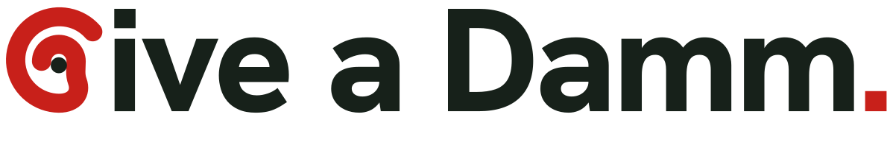

<p align="center">
  <picture>
    <source media="(prefers-color-scheme: dark)" srcset="docs/brand/svg/title-oneline-dark.svg">
    
  </picture>
</p>

<p align="center">
  <b>Three questions a day. Fully anonymous. Answers HR can act on.</b><br>
  An active-listening platform for Estrella Damm · UAB THE HACK 2026
</p>

<p align="center">
  <a href="https://web-production-6e775.up.railway.app" target="_blank" rel="noopener">Live demo</a> ·
  <a href="#the-loop">How it works</a> ·
  <a href="#anonymity-you-can-check">Anonymity</a> ·
  <a href="#the-engine">The engine</a> ·
  <a href="#run-it-in-two-minutes">Run it</a>
</p>

---

## The problem

Annual engagement surveys are long, rare and answered by the people who already wanted to talk. Night shifts and plant floors answer least. Results arrive months later as averages, so a small group with a real problem disappears inside the mean. And nobody answers honestly if they fear being identified.

That leaves three gaps: **tailoring**, **representativeness** and **trust**.

## What Give a Damm does

Instead of one long survey a year, every employee gets three short questions a day on their phone. HR can ask a new question in plain words, and the platform turns all answers into scores, alarms and proposed actions, without ever showing an individual answer.

- **HR writes a need in natural language.** "We want to know how plant teams experience the new shift system." The AI drafts the questions in Catalan, Spanish and English.
- **A human approves every question.** Nothing reaches an employee until HR has reviewed it. The AI proposes, a person decides.
- **One tap to publish.** Approved questions enter the pool and a web push reaches the phones of that collective.
- **Employees answer in under a minute.** An installable web app, no email, no phone number, no name.
- **The engine listens continuously.** It picks each person's daily questions, tracks every domain with a confidence figure, and raises an alarm when something really changes.
- **HR gets an action, not just a chart.** Each alarm comes with proposed recommendations; an approved one becomes a follow-up query, and the platform later compares the score before and after.

## The loop

```
  Ask                     Listen                      Understand                 Act
 ─────────────────────   ─────────────────────────   ────────────────────────   ──────────────────────
  Need in plain words  →  Publish + web push       →  Scores with confidence  →  AI-proposed actions
  AI drafts (ca/es/en) →  Answer on the phone      →  Alarms and weak signals →  Human approves
  Human approves       →  Engine picks the next Qs →  Comment themes          →  Follow-up query
                                                                               →  Listen again: before vs after
```

The whole challenge flow is covered end to end: need, AI drafts, human approval, publish, mobile answer, analysis (themes, trends, weak signals), dashboard with representativeness, recommendations and follow-up survey.

## Three experiences

| Who | Where | What they see |
|---|---|---|
| **Employee** | Installable PWA (`/`) | Join code, username and password, then a short daily batch of questions with an optional comment. Push notifications when HR publishes. Clear copy on what is and is not stored. |
| **HR** | Dashboard (`/hr`) | *Ask* (question bank, queries), *Listen* (engine console, links and QR per collective, Teams card), *Understand* (alarms, comment themes, results, recommendations), plus traceability and a methodology page that explains every number. |
| **Manager** | `/manager` | Their own collective only, only groups of 10 or more. Leadership alarms never go to the manager being assessed. |

The interface is trilingual (Catalan, Spanish, English), including the question bank.

## Anonymity you can check

Anonymity is not a policy promise here. It is a property of the code that anyone can verify.

- **Minimum group size of 10, everywhere.** Any segment (collective, shift, period, domain, theme) under 10 respondents is suppressed in the dashboard, the exports, the alarms and the recommendations. The rule is enforced when numbers are computed and again when they are read.
- **No personal data at signup.** A join code identifies company and collective; the person picks a username and password. The account maps to an opaque internal ID. Credentials are salted and hashed (scrypt), recovery uses a one-time code.
- **HR code physically cannot read raw answers.** HR routes may import only `@damm/db/hr` and `@damm/shared`; a lint rule enforces it. `pnpm check:anonymity` fails the build if HR code touches raw responses or accounts, or if the analytics view exposes an account ID.
- **Comments are redacted before they are stored**, summaries are built from counts, and an LLM summary that copies five words from a comment is thrown away.
- **No differencing attacks.** Shares are computed among visible groups only, and alarms are evaluated on non-nesting segments, so a hidden group cannot be recovered by subtraction.
- **Push subscriptions** live in their own table, are deleted on logout and are never joined to analytics. HR sees only "sent to fewer than 10 devices" below the threshold.
- **Safety and harassment comments** are counted in aggregate only and point the person to the official confidential channel (Ley 2/2023).

See [`docs/security-demo.md`](docs/security-demo.md) for the live walkthrough.

## The engine

`packages/engine` is a small, dependency-free set of Bayesian models that learn online. Every answer updates them in closed form in microseconds, and every number they produce can be explained to HR.

| Piece | Method |
|---|---|
| **Common answer space** | Seven question types (0–10, Likert, yes/no, this-or-that, pick one, ranking, open) all map to a score in [0, 1], with polarity and a learned per-item wording bias, so different questions can be analysed together. |
| **Personal trajectory** | A local-level Kalman filter per person and domain. It never leaves the engine. |
| **Smart follow-ups** | A surprising answer (\|z\| ≥ 2.5) schedules a follow-up 3–7 days later on the same facet with a different item, so noise is separated from real change. |
| **Segment score, confidence, consensus** | The person, not the answer, is the unit. Recency-weighted, with a finite-population correction against the synthetic headcount: confidence rises when more of a group has spoken and decays when nobody has lately. |
| **Daily batch** | Domains drawn in proportion to information gain, with a floor so no domain goes silent, a boost where outliers exceed chance, and HR needs first. |
| **Format choice** | Thompson sampling per collective and shift: if night shift answers 1–5 scales carefully and rushes yes/no, the engine leans to scales. HR can ban or weight formats. |
| **Insights** | Top movers, polarisation, importance vs satisfaction, trajectory mix, shift and manager gaps, and *listen again*: before vs after an adopted recommendation, worded "since X", never as proof of cause. |
| **Alarms** | Sharp drop, sustained decline, change-point clusters, polarisation, weak signals, emerging comment themes, low participation, low confidence, improvement. Each with hysteresis, cooldown and routing. |
| **Probes** | HR can ask the engine to dig deeper into one segment and domain for a while, without adding questions to anyone's day. |

Comment themes are classified by a trilingual lexicon (91.2 % top-1, 97.4 % recall on the synthetic comments; the LLM path exists for real free text). The engine has **178 tests**, including invariants, anonymity, robustness, a soak test and a simulator that tunes the hyperparameters against planted ground truth. Full spec: [`docs/engine.md`](docs/engine.md).

## AI where it helps, a human where it matters

The LLM (an OpenAI-compatible gateway served by UAB DCC) drafts questions from a need, translates them, checks their wording, optionally classifies and summarises comments, and drafts recommendations. Every output is a proposal:

- Drafted questions go to review; wording warnings never block a human decision.
- Recommendations are approved or discarded by HR.
- The LLM is called only in jobs and in the drafting step, **never while a dashboard page loads**.
- Every AI step has a deterministic fallback (template drafts, lexicon, template recommendations), so the whole product runs without a key.

How drafting is evaluated: [`docs/ai-drafting-eval.md`](docs/ai-drafting-eval.md).

## Synthetic data, with something to find

No real Damm or personal data is used anywhere. `pnpm demo-db` builds one trilingual database with 99 days of synthetic answers (1 August to 7 November 2026) across 4 collectives (Fàbriques, Logística, Comercial, Oficines) and 6 domains (Benestar, Lideratge, Desenvolupament, Cultura i pertinença, Entorn i relacions, Condicions i organització).

Signals are planted on purpose so the analysis has something to discover:

- a sharp drop in Fàbriques on working conditions,
- an October emerging theme on shift-system communication and breaks,
- polarisation in Oficines,
- a weak signal, and a heat and protective-equipment theme in Logística comments,
- low night-shift participation and a manager positivity bias.

This proves the mechanics, not real findings. A pilot with consented data is the next step.

## Run it in two minutes

Requires Node 22.6+ and pnpm 10.

```bash
pnpm install
cp .env.example .env    # optional: fill in the LLM key, VAPID keys, HR_ACCESS_CODE; never commit .env
pnpm demo-db            # builds data/app.db, about 90 s
pnpm dev                # http://localhost:3000
```

- **Employee:** open `/join/DEMO-FAB` (also `DEMO-LOG`, `DEMO-COM`, `DEMO-OFI`) and create an account.
- **HR:** sign in at `/hr-login` with your `HR_ACCESS_CODE`.
- **Manager:** `/manager`.

Checks:

```bash
pnpm --filter @damm/engine test          # engine test suite
pnpm --filter @damm/engine run health    # sanity check on the live DB: ranges, suppression, no NaN
pnpm check:anonymity                     # fails if HR code can reach raw answers
pnpm lint
pnpm build
```

Push notifications need public HTTPS: use the deployed URL or a tunnel and set `PUBLIC_BASE_URL`. On iOS, add the app to the home screen first. Deployment: [`docs/deploy.md`](docs/deploy.md).

## Architecture

One TypeScript monorepo, one backend process, one SQLite file, with strict module boundaries. Fast to build and demo, cheap to split into services later.

```
apps/web/            Next.js app: employee PWA, HR dashboard, manager view, API routes
packages/db/         schema, migrations, repositories (raw side and the HR-only side)
packages/shared/     types, zod schemas, constants
packages/engine/     scheduling, scores, follow-ups, insights, alarms, comments, recommendations
packages/ai/         drafting, translation, quality checks, redaction, recommendations (LLM + fallbacks)
packages/seed/       synthetic population and comment bank
scripts/             demo DB build, anonymity check, security and suppression demos
```

The employee side and the HR side meet only through the database and two endpoints: `GET /api/pool/next` (questions for an account) and `POST /api/responses` (answers in). Jobs write aggregate tables; the dashboard reads only those.

## Limits, stated plainly

- Synthetic data proves the mechanics, not conclusions.
- Self-selected response: the gap is measured and flagged on the same page as every insight, but it cannot be removed.
- The threshold of 10 protects people and costs resolution; small sites need a policy decision.
- The comment lexicon was tuned on synthetic phrasings; real free text will score lower.
- iOS push needs the app on the home screen.

## What comes next

- Split along the existing boundaries: a central server that sends questions out and receives anonymised answers back, and company-side apps.
- Native Android app (Capacitor + FCM) and a Microsoft Teams bot ([`docs/teams-integration.md`](docs/teams-integration.md)).
- Engine priors warm-started from public workplace surveys, and a learned answer-propensity model behind the same interfaces.

## Documentation

| Doc | What |
|---|---|
| [`docs/requirements.md`](docs/requirements.md) | every challenge requirement with its status and where it lives in the code |
| [`docs/engine.md`](docs/engine.md) | the engine model in full |
| [`docs/engine-integration.md`](docs/engine-integration.md) | how the app, dashboard and jobs call the engine |
| [`docs/question-types.md`](docs/question-types.md) | every question type with examples |
| [`docs/user-flows.md`](docs/user-flows.md) | flows per persona with the exact UI copy |
| [`docs/security-demo.md`](docs/security-demo.md) | anonymity and security walkthrough |
| [`docs/demo-script.md`](docs/demo-script.md) | the live demo, beat by beat |
| [`docs/style-guide.md`](docs/style-guide.md) | the Give a Damm visual identity |
| [`AGENTS.md`](AGENTS.md) | team workflow, product decisions and architecture |

## Team

Built in one weekend by **Jan** and **Natan** for Estrella Damm at UAB THE HACK 2026.

> Every employee can speak, HR can act, and nobody can be identified.
